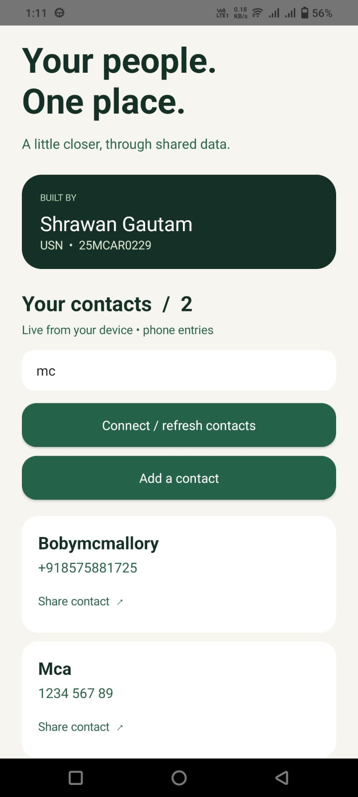
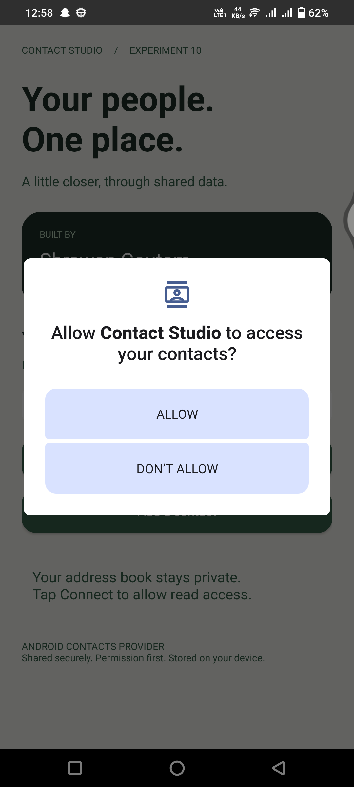
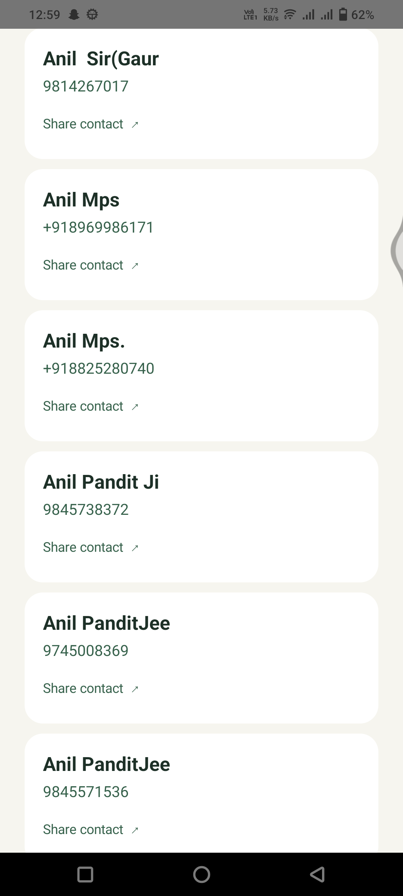

# Experiment 10 — Contact Studio

**Implement data sharing using Contacts Content Provider**  
**Student:** Shrawan Gautam  
**USN:** 25MCAR0229  
**Language:** Java · Native Android

## Aim
Build an Android application that accesses contact information maintained by another application through Android's Contacts Content Provider, with runtime permission and a user-initiated sharing action.

## Concept and technology
A Content Provider exposes structured data through content URIs. Applications use a ContentResolver rather than opening another application's private database. Android's Contacts Provider maintains contacts, raw contacts and data records. This project queries `ContactsContract.CommonDataKinds.Phone.CONTENT_URI`, requesting DISPLAY_NAME and NUMBER. Each result is a phone entry, so a person with multiple numbers can appear multiple times; contacts without numbers are excluded.

`READ_CONTACTS` is declared in the manifest and requested at runtime. The query runs on a background executor, its Cursor is closed using try-with-resources, and results are rendered on the UI thread. Search filters the retrieved entries locally. The refresh action and returning to the activity reload provider data. The app's Add action delegates editing to the installed Contacts app using ACTION_INSERT, so it does not need WRITE_CONTACTS. Share sends the selected name and number as plain text to Android's chooser using ACTION_SEND; users choose a recipient application themselves.

Reference: [Android Developers — Contacts Provider](https://developer.android.com/identity/providers/contacts-provider).

## Demonstration scenario
A student wants to locate and share a classmate's contact. Save a sample phone contact in the emulator's Contacts app, return to Contact Studio, grant Contacts access and locate the entry. Tap Share contact to open Android's chooser. The identity card identifies the experiment author; it is independent of the device address book. The screenshots below were supplied by the student after testing on an Android phone.

## Features
- Warm ivory, forest-green cards and clear typography.
- Visible student name and USN.
- Runtime permission handling and Settings recovery after permanent denial.
- Provider-backed contact listing and case-insensitive search.
- Add contact through the system contact editor.
- Share an entry using Android's share sheet.
- Empty and no-match states.
- No internet permission or remote storage.

## Run
1. Open this folder in Android Studio.
2. Install Android SDK Platform 36 and select JDK 17 or a compatible newer Gradle JDK.
3. Let Gradle sync (the first run needs internet for dependencies).
4. Start an emulator or connect an Android device running Android 8.0/API 26 or later.
5. Run `app`. Tap Connect / refresh contacts and allow access.
6. If empty, tap Add a contact, save a name and phone number, then return.

Windows build: `gradlew.bat assembleDebug`  
macOS/Linux build: `chmod +x gradlew && ./gradlew assembleDebug`  
APK after building: `app/build/outputs/apk/debug/app-debug.apk`.

## Folder and file structure
```text
Experiment10/
├── README.md                       Experiment explanation and test evidence
├── .gitignore                      Excludes generated and machine-local files
├── settings.gradle                 Repositories and app module registration
├── build.gradle                    Android plugin version
├── gradlew / gradlew.bat            Portable Gradle launchers
├── gradle/wrapper/                  Wrapper JAR and distribution configuration
├── app/
│   ├── build.gradle                SDK, Java and application configuration
│   └── src/main/
│       ├── AndroidManifest.xml     Permission and launcher activity
│       ├── java/com/shrawan/contactstudio/MainActivity.java
│       │                           UI, permission, provider query and sharing
│       └── res/values/styles.xml   Application theme
└── screenshots/                    Device screenshots and earlier emulator captures
```

The interface is built programmatically in Java; no layout XML or Kotlin source is required.

## Output
The application running on an Android phone, showing a filtered contact list and the student identity card:



## Three test cases

### TC01 — Request Contacts permission
**Precondition:** Contacts access has not yet been granted.  
**Steps:** Open the application and tap **Connect / refresh contacts**.  
**Expected:** Android asks whether Contact Studio may access contacts.  
**Actual result: PASS.** The supplied screenshot shows the system permission dialog with **ALLOW** and **DON'T ALLOW** choices. This capture demonstrates the request, not the outcome of denying permission.



### TC02 — Read and display device contacts
**Precondition:** The phone contains contacts with phone numbers.  
**Steps:** Allow Contacts access, refresh the list, then scroll through the results.  
**Expected:** Contact names and phone numbers from the Contacts Provider appear in cards with a Share contact action.  
**Actual result: PASS.** The supplied screenshot shows multiple contact entries displayed in the scrolling list.



### TC03 — Search contacts and verify student identity
**Precondition:** Contacts have loaded successfully.  
**Steps:** Enter **mc** in the search field and inspect the filtered list and author card.  
**Expected:** Only matching entries remain, the displayed count reflects the results, and the author card shows **Shrawan Gautam** and **25MCAR0229**.  
**Actual result: PASS.** The supplied screenshot shows the query **mc**, two matching entries and a count of **2**, together with the student's name and USN.


## GitHub submission
Create an empty GitHub repository, open a terminal in this folder and run:
```sh
git init
git add .
git commit -m "Add Experiment 10 Contacts Content Provider"
git branch -M main
git remote add origin https://github.com/YOUR_USERNAME/YOUR_REPOSITORY.git
git push -u origin main
```
Replace the URL with your own repository. Upload README.md and the entire screenshots folder together, preserving their relative locations. The README images use relative paths so they render on GitHub. Do not upload local.properties, build directories or .gradle caches. Submit the repository link to your professor.

## Limitations
This teaching application uses a simple scrolling list intended for small demonstration address books. It shares plain text, not a vCard. Actual sharing targets depend on installed apps. Contact insertion requires an installed Contacts editor. The application reloads on resume/refresh rather than continuously observing provider changes.

## Verification record
The project was previously built successfully with Gradle 9.5.0 / Android Gradle Plugin 9.3.2 and run on the Pixel_9a emulator. The three test cases above now use the newer phone screenshots supplied by Shrawan Gautam: permission request, contact listing, and search with student identity. Results describe what is visible in those screenshots. Earlier emulator captures remain in the screenshots folder as supplementary evidence; they are not the screenshots used for these three cases.

