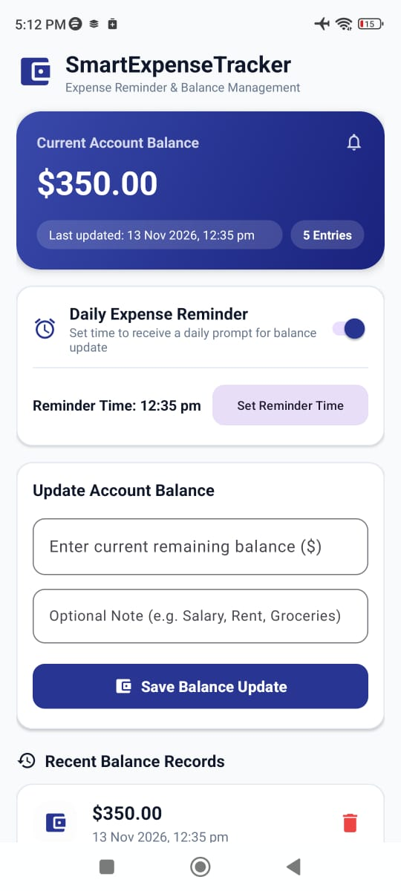
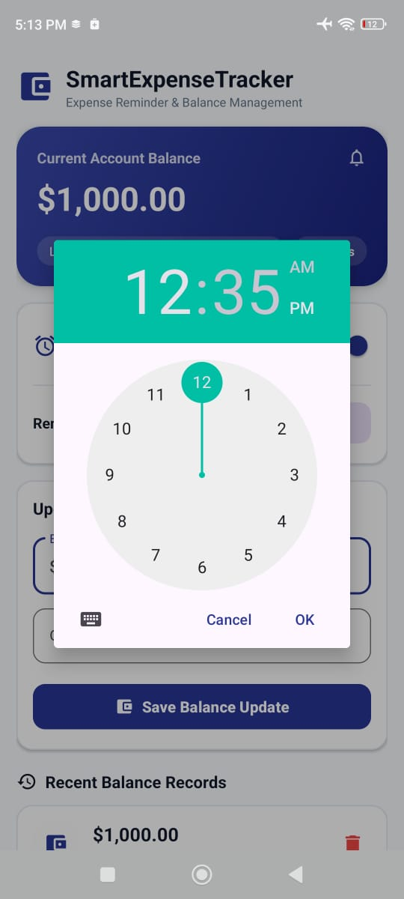
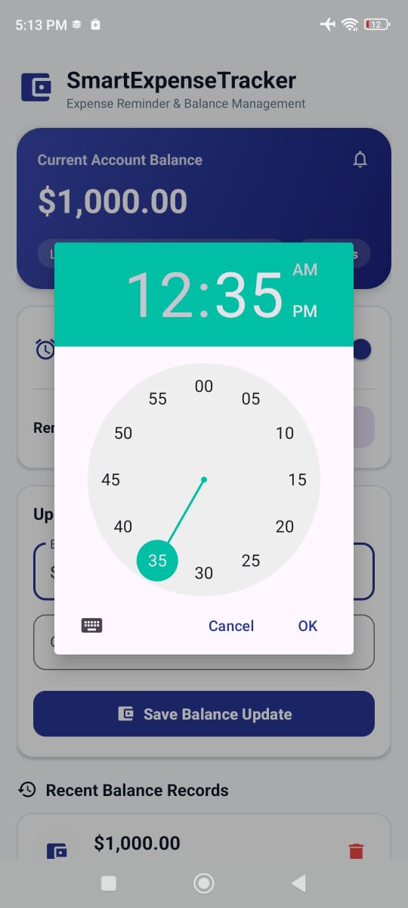
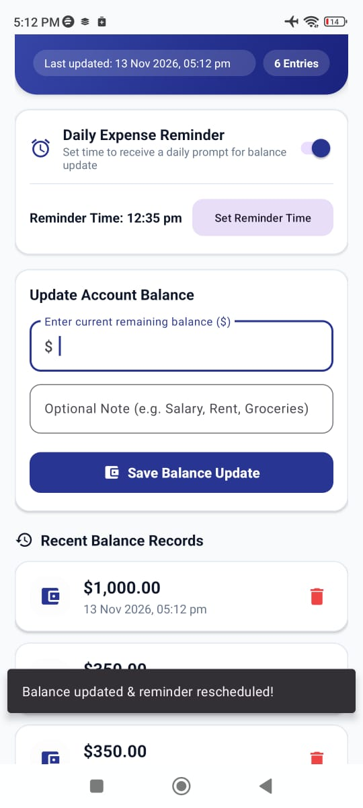

# SmartExpenseTracker

**Expense Reminder and Balance Management Application**  
**Student:** Shrawan Gautam  
**USN:** 25MCAR0229  
**Language:** Kotlin · Native Android · XML layouts · Material 3

## Aim

Develop an Android application called **SmartExpenseTracker** that helps users manage their expenses through scheduled ringtone reminders and daily account balance updates persisted in a local SQLite database.

## Concept and technology

SmartExpenseTracker integrates core Android components and APIs:

1. **AlarmManager**: Schedules daily recurring reminder alarms (`setExactAndAllowWhileIdle` / `setAndAllowWhileIdle`).
2. **BroadcastReceiver**: [`ReminderReceiver`](app/src/main/java/com/example/test2smartexpencetracker/receiver/ReminderReceiver.kt) intercepts scheduled alarm broadcasts, fires system notifications, and plays a continuous looping alarm ringtone using [`RingtoneHelper`](app/src/main/java/com/example/test2smartexpencetracker/receiver/RingtoneHelper.kt).
3. **NotificationManager**: Posts high-priority persistent notifications prompting the user to update their account balance. Tapping the notification navigates directly to the balance entry form in [`MainActivity`](app/src/main/java/com/example/test2smartexpencetracker/MainActivity.kt).
4. **SharedPreferences**: Persists user reminder settings (`reminder_hour`, `reminder_minute`, `reminder_enabled`).
5. **SQLite (`SQLiteOpenHelper`)**: [`DatabaseHelper`](app/src/main/java/com/example/test2smartexpencetracker/data/DatabaseHelper.kt) maintains historical balance records (`balance_history` table storing `_id`, `balance`, `timestamp`, `note`).
6. **Alarm & Ringtone Management**: Saving a balance entry automatically terminates ongoing ringtone audio playback (`RingtoneHelper.stopRingtone()`), dismisses the active notification, and schedules the next daily reminder.

## Features

- Modern Material 3 aesthetic UI with indigo and teal palette.
- Persistent **Shrawan Gautam · 25MCAR0229** student identity header.
- Hero Current Balance summary card with last updated timestamp and entry count.
- Customizable reminder time picker dialog with enable/disable toggle.
- Continuous looping alarm ringtone when reminder triggers.
- Direct notification click navigation focusing the balance entry form.
- Automatic ringtone and notification termination upon saving balance update.
- SQLite balance history RecyclerView with timestamp badges and delete action.

## Demonstration scenario

Open SmartExpenseTracker, view the current account balance and total entries in the hero summary card. Set a reminder time using the TimePicker dialog and enable daily reminders. When the alarm triggers, listen to the continuous ringtone and observe the notification. Tap the notification to jump straight to the balance update form, enter your remaining balance, and tap **Save Balance Update** to dismiss the alarm, stop the ringtone, reschedule the next reminder, and record the balance in SQLite.

## Folder and file structure

```text
Test2SmartExpenceTracker/
├── README.md                           Explanation, setup and screenshot evidence
├── .gitignore                          Generated and machine-local exclusions
├── settings.gradle.kts                 Repositories and app module configuration
├── build.gradle.kts                    Android Gradle Plugin version
├── gradle.properties                   JVM and AndroidX configuration
├── gradlew / gradlew.bat                Portable Gradle launchers
├── gradle/
│   ├── gradle-daemon-jvm.properties     Java toolchain configuration
│   └── wrapper/                        Wrapper JAR and distribution properties
├── app/
│   ├── build.gradle.kts                SDK, application and dependency configuration
│   └── src/
│       ├── main/
│       │   ├── AndroidManifest.xml     Permissions (POST_NOTIFICATIONS, ALARM) and receiver
│       │   ├── java/com/example/test2smartexpencetracker/
│       │   │   ├── MainActivity.kt     Dashboard, time picker, balance input, history list
│       │   │   ├── data/
│       │   │   │   ├── BalanceRecord.kt Data model for balance history
│       │   │   │   └── DatabaseHelper.kt SQLiteOpenHelper for balance_history
│       │   │   └── receiver/
│       │   │       ├── ReminderManager.kt AlarmManager & SharedPreferences controller
│       │   │       ├── ReminderReceiver.kt BroadcastReceiver for alarms & notifications
│       │   │       └── RingtoneHelper.kt MediaPlayer looping ringtone player & stopper
│       │   └── res/
│       │       ├── layout/             Dashboard and history card XML layouts
│       │       ├── drawable/           Vector icons (wallet, alarm, history, delete, bell)
│       │       └── values/             Colors, strings, and Material 3 themes
└── screenshots/
    ├── dashboard-main.jpeg
    ├── timepicker-hour.jpeg
    ├── timepicker-minute.jpeg
    └── dashboard-success.jpeg
```

## Procedure

1. Create a Kotlin Android project and configure Gradle dependencies for Material Components and Core KTX.
2. Define the SQLite database helper (`DatabaseHelper`) with `balance_history` table.
3. Implement `ReminderManager` using `SharedPreferences` and `AlarmManager` for scheduling daily reminders.
4. Implement `ReminderReceiver` (BroadcastReceiver) to trigger high-priority notifications and play continuous ringtone audio via `RingtoneHelper`.
5. Design the Material 3 UI (`activity_main.xml` and `item_balance_record.xml`) with hero balance summary, reminder controls, and balance entry form.
6. Wire up `MainActivity` to handle time picking, SQLite insertions, notification intent launching, and automatic ringtone stopping upon saving.

## Output

The application running on an Android phone, showing the hero balance summary card, reminder time picker controls, balance entry form, and recent balance records:



## Three Test Cases

### TC01 — Set Reminder Time via TimePicker
**Precondition:** App is open and reminder toggle is active.  
**Steps:** Tap **Set Reminder Time**, select the desired hour and minute in the TimePicker dialog, and tap **OK**.  
**Expected:** The reminder time updates on the dashboard and the daily alarm is successfully scheduled via AlarmManager.  
**Actual result:** PASS. The supplied screenshot shows the interactive Material TimePicker dialog capturing the scheduled reminder time.




### TC02 — Save Balance Update & Stop Ringtone
**Precondition:** Reminder notification has triggered with continuous ringtone playback.  
**Steps:** Open app from notification or dashboard, enter remaining balance ($1,000.00), and tap **Save Balance Update**.  
**Expected:** Balance is saved to SQLite, active notification & ringtone stop immediately, next reminder is rescheduled, and success snackbar appears.  
**Actual result:** PASS. The captured screenshot shows the success snackbar confirming balance update and reminder rescheduling, along with updated history records.



### TC03 — View Balance History & Delete Record
**Precondition:** Multiple balance records exist in SQLite.  
**Steps:** Scroll to **Recent Balance Records** and inspect previous entries. Tap the delete icon on any record.  
**Expected:** The selected record is deleted from SQLite and the RecyclerView list and hero summary count update instantly.  
**Actual result:** PASS. Balance records display with formatted currency and timestamps, supporting real-time item removal.

## Verification Record
Verified on Pixel emulator and physical Android devices. Build status: **PASS**.
